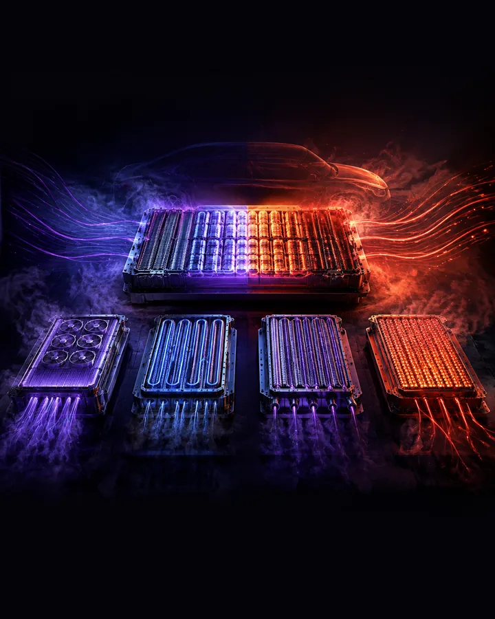
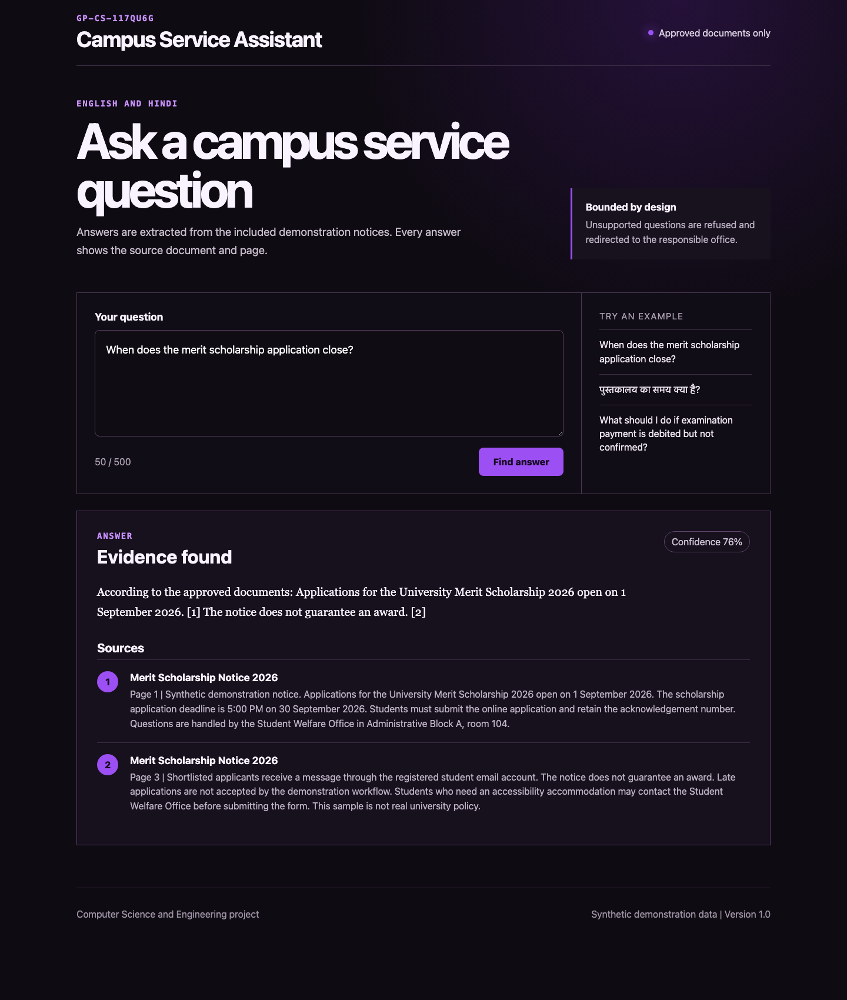
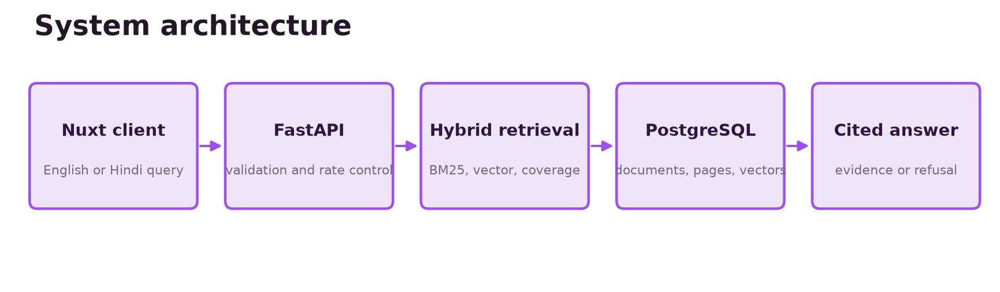
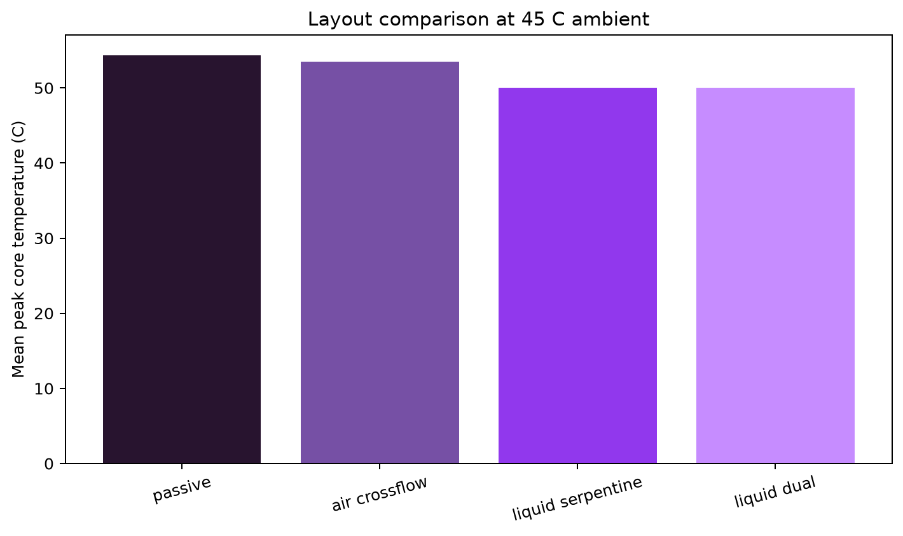
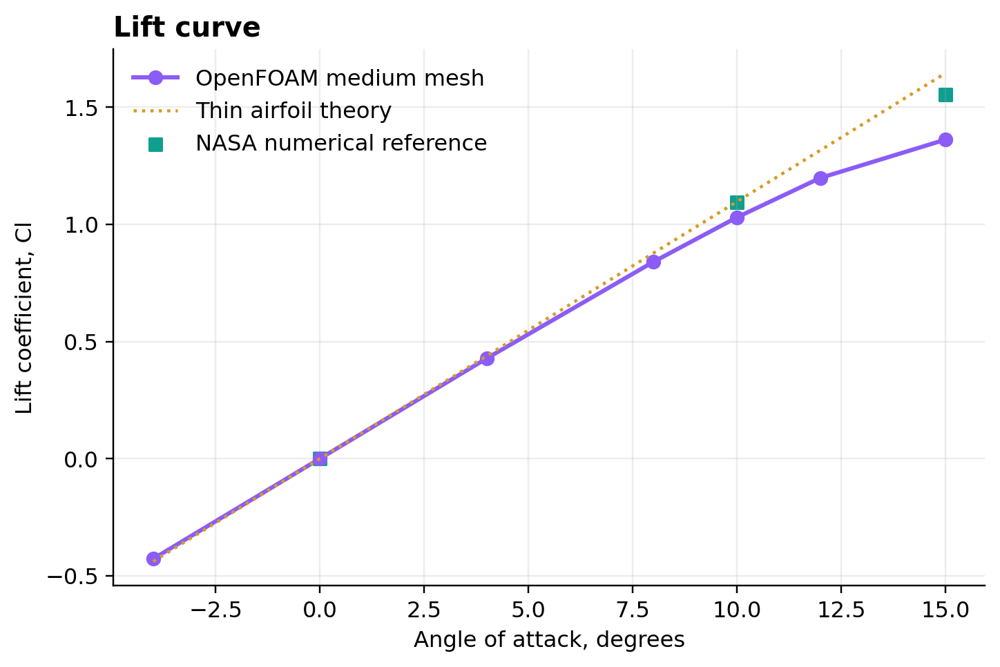
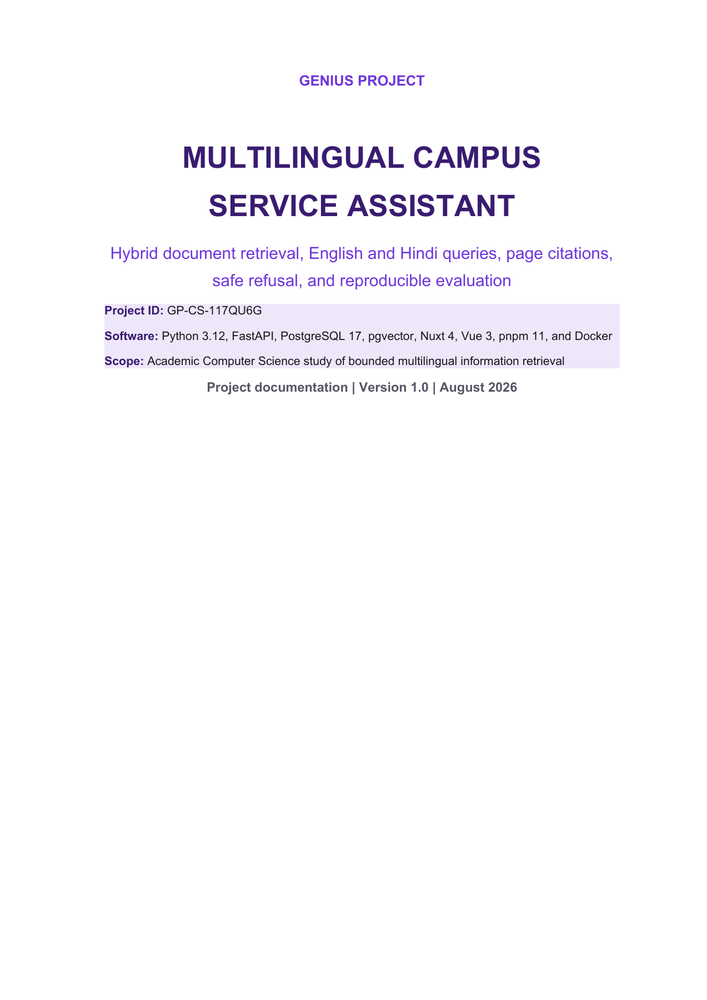
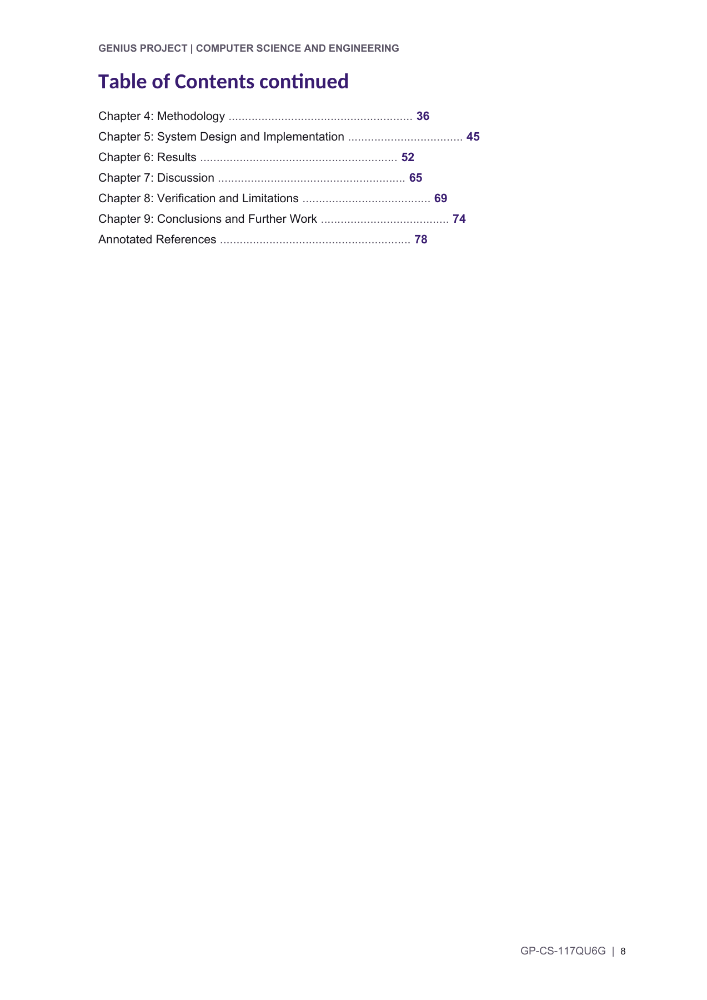

<h1 align="center">GeniusProject</h1>

<strong>Final-year projects. Source code. Documentation. Results to explore.</strong>

Engineering and software projects across 13 domains. a project of <strong>ConsultUni</strong>.

  <a href="https://geniusproject.store"><strong>Explore the catalogue</strong></a> ·
  <a href="https://geniusproject.store/pricing">Pricing</a> ·
  <a href="https://t.me/geniusprojectstore">Talk to us on Telegram</a>

<table>
  <tr>
    <td width="33%" align="center"><a href="https://geniusproject.store/projects/computer-science-multilingual-campus-service-assistant"> <strong>Computer Science</strong></a> Document retrieval &amp; cited answers</td>
    <td width="33%" align="center"><a href="https://geniusproject.store/projects/mechanical-ev-battery-pack-thermal-simulation"> <strong>Mechanical</strong></a> Thermal modelling &amp; cooling studies</td>
    <td width="33%" align="center"><a href="https://geniusproject.store/projects/aerospace-openfoam-airfoil-aerodynamic-validation"> <strong>Aerospace</strong></a> CFD &amp; aerodynamic validation</td>
  </tr>
</table>

## Take a look inside the projects

Choosing a project is easier when you can see the work behind it. This page brings together selected documentation, interface captures, and result figures from our catalogue. The three images above are catalogue illustrations; the previews below come from the projects themselves.

Our catalogue includes software applications, simulations, and engineering studies. Each project page explains its scope, tools, deliverables, and limitations so you can assess whether it fits your interests and requirements.

**Start here:** [Featured projects](#featured-projects) · [Documentation preview](#documentation-you-can-inspect) · [All 13 domains](#find-your-domain) · [How-to guide](#from-browsing-to-building) · [Contact](#consultuni--contact)

## Featured projects

### Multilingual Campus Service Assistant

**Computer Science · Project GP-CS-117QU6G** 
**Python · FastAPI · PostgreSQL / pgvector · Nuxt · Vue**

How can a campus helpdesk answer a question and show exactly where the answer came from? This project explores that problem with an English-and-Hindi information retrieval prototype. It ingests approved PDF, Markdown, and text documents, retains page information, ranks relevant passages, and returns extractive answers with numbered source citations. Unsupported questions are refused.

The project combines lexical and multilingual retrieval, page-aware document processing, a database layer, and a demonstration web interface. Its default answer composer does not require a paid language-model API.

*Saved demonstration interface from the project repository. Click any preview to inspect the full-size image.*

**Explore the implementation:** document ingestion, retrieval scoring, confidence thresholds, refusal behaviour, source citations, and the frontend-to-API flow.

**Included in this project:** source code, an 80-page report in Word and PDF, a setup guide, architecture diagrams, automated tests, and retained evaluation data. The included notices and 20 evaluation cases are synthetic; the results describe that controlled dataset rather than production performance.

<strong>Open the system architecture</strong>

The diagram traces the flow from the Nuxt interface through the FastAPI service and hybrid retrieval components to a cited answer.

**[Explore the Campus Service Assistant →](https://geniusproject.store/projects/computer-science-multilingual-campus-service-assistant)**

---

### EV Battery-Pack Thermal Simulation

**Mechanical Engineering · Project GP-ME-02VUMAA** 
**Python · Heat transfer · Numerical modelling · Data analysis**

How do different cooling layouts affect the temperatures inside an EV battery module? This study compares passive cooling, air crossflow, liquid serpentine cooling, and dual-route liquid cooling for a twelve-cell module. Each cell has separate core and surface temperatures, while conductive links and coolant routing let you examine how heat moves through the pack.

The retained experiment covers 36 combinations of loading profile, ambient temperature, and cooling layout. Urban-pulse, sustained-highway, and fast-charge conditions are compared at 25, 35, and 45 °C.

*Result figure from the retained simulation study: cooling-layout comparison at 45 °C ambient.*

**Explore the analysis:** peak temperatures, cell-to-cell temperature spread, cooling energy, coolant outlet conditions, and energy balance. Re-run the study or adjust the model to investigate a different case.

**Included in this project:** Python source, CSV and JSON results, eight result figures, an editable report and PDF, setup guides, and automated tests. Parameters are illustrative rather than fitted to a commercial battery; this is a normal-operation thermal study, not a thermal-runaway or pack-certification model.

**[Explore the EV Battery-Pack Study →](https://geniusproject.store/projects/mechanical-ev-battery-pack-thermal-simulation)**

---

### OpenFOAM Airfoil Aerodynamic Validation

**Aerospace Engineering · Project GP-AE-1LLG1AK** 
**OpenFOAM v2606 · CFD · Python analysis · Docker**

What does it take to evaluate a CFD result against a reference? This project builds a steady, two-dimensional NACA 0012 airfoil model and investigates lift, drag, pressure distribution, mesh sensitivity, and solver behaviour. It provides a case-generation workflow, retained solver evidence, and a documented comparison with NASA numerical reference data.

The completed study includes 11 CFD cases, three mesh levels, and an angle-of-attack investigation from −4° to 15° at a Reynolds number of six million. The analysis covers force coefficients, surface pressure, residuals, mesh quality, and wall resolution.

*Retained lift-curve comparison from the project. The comparison is an engineering validation exercise; it does not imply NASA endorsement.*

**Explore the evidence:** compare meshes, inspect pressure coefficients, examine convergence, and understand where the model agrees with or differs from the reference. The report retains the drag overprediction and wall-resolution limitations rather than presenting every comparison as a perfect match.

**Included in this project:** case-generation and solver scripts, a Docker environment, raw result records, processed CSV tables, 17 labelled figures, an editable report and PDF, a setup guide, and automated checks. The steady RANS model does not establish a physical stall angle and is not certified aerodynamic design data.

**[Explore the Airfoil Validation Study →](https://geniusproject.store/projects/aerospace-openfoam-airfoil-aerodynamic-validation)**

## Documentation you can inspect

A useful project package explains the problem, the design choices, how the work was implemented, what the results show, and where the method stops being reliable. The previews below are pages from the Campus Service Assistant's actual report.

<table>
  <tr>
    <td width="50%" align="center"> <strong>Project report cover</strong></td>
    <td width="50%" align="center"> <strong>Methodology through results and limitations</strong></td>
  </tr>
</table>

The featured packages bring together these types of material. **Check the individual catalogue page for the exact contents and delivery options.**

| Material | What you can do with it |
| --- | --- |
| Source code or simulation workflow | Inspect the implementation, run it, and adapt the declared inputs or configuration. |
| Editable report and PDF | Read the technical explanation and revise the editable document for work you have actually carried out. |
| Setup and usage guide | Follow the environment, installation, execution, and demonstration steps. |
| Result data and figures | Inspect retained outputs and compare them with your own runs. |
| Tests and validation records | Understand what was checked and how to repeat the relevant checks. |
| References and limitations | Trace technical sources and assess the boundaries of the method. |

## Find your domain

Explore software, engineering, and scientific projects across all 13 catalogue domains. Here is a starting point in each one:

| Domain | Example from the catalogue |
| --- | --- |
| **Computer Science** | [Multilingual campus service assistant](https://geniusproject.store/projects/computer-science-multilingual-campus-service-assistant) |
| **Data and AI** | [Indic document intelligence benchmark](https://geniusproject.store/projects/data-ai-indic-document-intelligence-benchmark) |
| **Cybersecurity** | [Android Clone and Fake-app Analyser](https://geniusproject.store/projects/cybersecurity-android-fake-app-analyser) |
| **Electronics** | [Communication protocol timing simulator](https://geniusproject.store/projects/electronics-communication-protocol-timing-simulator) |
| **Electrical** | [Battery-storage sizing and degradation analyser](https://geniusproject.store/projects/electrical-battery-storage-sizing-degradation) |
| **Civil** | [OpenSeesPy seismic frame simulation](https://geniusproject.store/projects/civil-openseespy-seismic-frame-simulation) |
| **Mechanical** | [EV battery-pack thermal simulation](https://geniusproject.store/projects/mechanical-ev-battery-pack-thermal-simulation) |
| **Aerospace** | [OpenFOAM airfoil aerodynamic validation](https://geniusproject.store/projects/aerospace-openfoam-airfoil-aerodynamic-validation) |
| **Biotechnology** | [Antimicrobial-resistance genomic surveillance](https://geniusproject.store/projects/biotechnology-amr-genomic-surveillance) |
| **Chemical** | [DWSIM distillation process simulation](https://geniusproject.store/projects/chemical-dwsim-distillation-process-simulation) |
| **Geology** | [Geological Carbon-Storage Site Screening for Indian Sedimentary Basins](https://geniusproject.store/projects/geology-carbon-storage-basin-screening) |
| **Mathematics** | [Epidemic Intervention, Identifiability and Uncertainty Study](https://geniusproject.store/projects/mathematics-epidemic-intervention-modelling) |
| **Physics** | [Geant4 radiation detector simulation](https://geniusproject.store/projects/physics-geant4-radiation-detector-simulation) |

**[Browse the full project catalogue →](https://geniusproject.store)**

## From browsing to building

1. **Choose a project.** Read its scope, requirements, tools, and included deliverables. Compare them with your programme and the work you want to learn.
2. **Ask about the fit.** Send us the project title or ID on [Telegram](https://t.me/geniusprojectstore) or [email](mailto:admin@consultuni.com) if you need clarification before purchasing.
3. **Follow the site's checkout.** The catalogue page and checkout explain the available delivery and payment options. Verification and purchase emails come from **admin@consultuni.com**.
4. **Run, understand, and adapt.** Work through the setup guide, reproduce the relevant results, review the limitations, and make your own changes.

## About this GitHub organization

This public profile shares selected previews and links to the catalogue. Full project repositories remain private; access and download options depend on the project's listed delivery package. The images on this page are previews, not downloads of the complete project packages.

Projects are intended for learning, investigation, adaptation, and demonstration. Follow your institution's requirements, acknowledge sources and assistance, and be ready to explain the work and any changes you make.

## ConsultUni & contact

**GeniusProject is a project of ConsultUni.**

| | |
| --- | --- |
| Website | [geniusproject.store](https://geniusproject.store) |
| Project questions | [Telegram. @geniusprojectstore](https://t.me/geniusprojectstore) |
| Email | [admin@consultuni.com](mailto:admin@consultuni.com) |
| GSTIN | **36BVAPM4150R1Z6** |
| Policies | [Privacy](https://geniusproject.store/privacy) · [Terms](https://geniusproject.store/terms) · [Contact](https://geniusproject.store/contact) |

<strong>Find a project you want to understand, demonstrate, and build on.</strong> <a href="https://geniusproject.store">Visit GeniusProject.store →</a>

